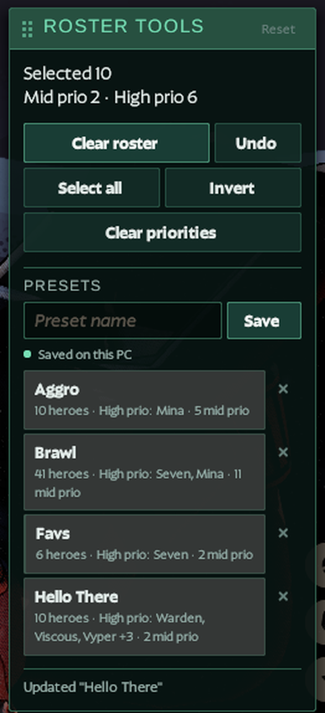
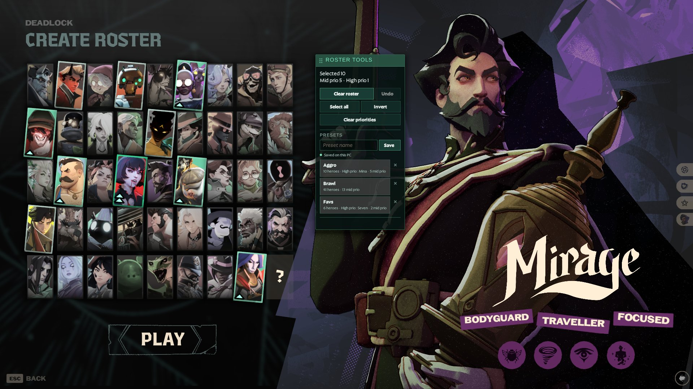
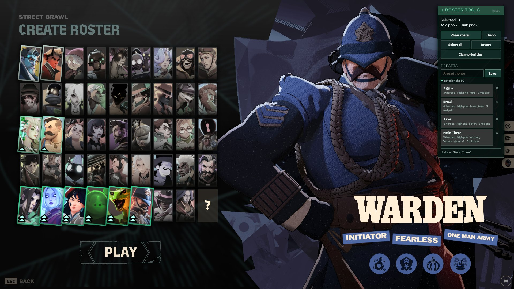

# Roster Tools for Deadlock

A UI-only Panorama mod for the hero roster screen. It adds a compact panel next to the hero grid:



- **Clear roster**: deselects every hero (Avoid Hero and the priority token card are left alone).
- **Undo**: restores the roster as it was before the last operation, priorities included (10 steps, kept until the game restarts).
- **Clear priorities**, **Select all** (skips locked and avoided heroes), **Invert**.
- **Saved presets**: save the current roster under a name and apply it later with one click. Each preset shows a short summary such as `12 heroes · High prio: Abrams, Haze · 3 mid prio`. Presets are kept between game sessions; deleting one takes two clicks.
- **Movable panel**: hold the left mouse button on the panel's header (the dotted grip) and drag. If dragging does not respond, click the header, move the mouse and click again to drop. The position is remembered; the small **Reset** in the header, shown only while a custom position is saved, puts the panel back next to the grid.
- **Live counter**: selected heroes and how many have mid or high priority (*Mid prio* = one right click, *High prio* = two), a hint when fewer than 3 heroes are selected, and the game's own roster error message.

> **Version 1.0.0**, built for Deadlock build 26224525.

## Screenshots





## Principles

- UI only: no DLLs, injectors or memory editing. The VPK contains two files: the stock roster layout with one added script `<include>`, and the script itself.
- Every roster change is a replayed card click started by a button press. Nothing runs on its own apart from refreshing the counter.
- The mod **never** presses Play/Confirm, never avoids a hero, never moves the priority token and never moves or recreates native panels.
- The panel hides itself in single-hero pickers (Hero Testing, Explore Map, draft).
- Safety stop: if a click ever changes a card's Avoid or token state, the operation stops immediately.

## Installation

**Download:** [GameBanana](https://gamebanana.com/mods/736394) or [GitHub Releases](https://github.com/piotrpanawas/deadlock-roster-mod/releases/latest).

**Deadlock Mod Manager (recommended):** use the Deadlock Mod Manager 1-click button on the [GameBanana page](https://gamebanana.com/mods/736394), or close the game → Mods Library → Add Local Mod → `roster-tools-1.0.0.zip` → enable → start the game.

**Manual:** copy `pak57_dir.vpk` to `game/citadel/addons/` (any free `pakNN` number). `gameinfo.gi` must mount `citadel/addons`, which mod managers usually set up already. From a clone of this repository: `tools/install.sh [--pak NN]`; to remove: `tools/uninstall.sh`.

**Conflicts:** any mod that replaces `panorama/layout/popups/citadel_popup_roster_select.vxml_c` (Hero Select Plus, Release Order Roster, New roster hero select screen). Enable only one of them.

**After a game update:** disable the mod until a build for the new layout is available. The build reports whether the stock layout fingerprint changed.

**Risk:** Valve has no official position on UI mods. HUD and cosmetic mods are common and, as far as is known, have not been punished, but there is no guarantee.

## Saved presets and privacy

Type a name (optional) and press **Save** or Enter to store the current roster. The roster popup sends every key to its built-in hero quick search, and a mod cannot change that. So while the name field is in use, the mod hides the search text, turns off its hero highlighting and copies what you type into the field, backspaces included. The game upper-cases everything typed there, so names are saved in Title Case. Saving under an existing name updates that preset. Applying a preset sets the saved heroes and deselects the rest; Avoid Hero, the priority token card and locked heroes are left alone.

Deadlock's Panorama UI has no storage of its own, so presets are kept in the `localStorage` of a tiny static page, the [storage bridge](https://github.com/piotrpanawas/deadlock-roster-tools-bridge), which the mod loads in an invisible 2×2 px `CitadelHTMLPanel`:

- The data stays **on your PC**, in the game's embedded browser profile. Requests travel in the URL fragment, which is never sent to a server, and answers come back through the page title.
- The page is downloaded from GitHub Pages once and cached by a service worker, so presets also work offline afterwards. GitHub sees the page request (like any web request), not your presets.
- Presets survive game restarts, updates and even uninstalling the mod.
- If the page cannot load (for example, the first start without internet), presets saved in that session last until the game restarts, and the panel says so.

Source of the page: [`bridge/`](bridge/), published with `tools/publish_bridge.sh`. The URL is set in `data/bridge.json`; an empty URL keeps presets in memory only.

## Building

Requirements: Linux x64, Python 3.11+, Node 18+ (tests), `curl`, `unzip`. The toolchain is downloaded into `.work/`; nothing is installed system-wide.

```bash
tools/setup.sh                        # Source 2 Viewer CLI 20.1 (SHA-256 pinned) + local .NET SDK 10
npm test                              # offline tests (JavaScript + Python)
python3 tools/build.py                # -> dist/roster-tools-1.0.0.zip, dist/pak57_dir.vpk, build.json, SHA256SUMS
python3 tools/build.py --check-only   # only compare the stock layout fingerprint
```

The build reads the stock layout from the installed game (`--game` or `DEADLOCK_ROOT`; Steam libraries are detected otherwise), adds the include with `tools/LayoutPatcher` (ValveResourceFormat), packs the VPK, reads it back with Source 2 Viewer and checks that the layout equals stock plus exactly one include. Builds are byte-for-byte reproducible.

## How it works

`src/panorama/roster_tools.js` runs in the `CitadelPopupRosterSelect` context:

- **Reading**: cards are `CitadelHeroCard` panels inside `#RosterHeroes`. The state comes from the `inRoster`, `isPriority` and `isHighPriority` classes, plus flags such as `isBanned`, `isPriorityToken` and `rankedLocked`. Heroes are identified by `#HeroName` (and `heroid` where available).
- **Actions**: `$.DispatchEvent('Activated', card, 'mouse')` for a left click and `ContextMenu` for a right click, with fallbacks. The working form is detected at runtime.
- **Reconcile**: for each card the engine plans the shortest click sequence to the target state. The transition table starts from the usual click rules and adapts to what the game actually does. A card that does not react cannot teach the engine a wrong rule.
- **Speed**: when the game updates a card synchronously, several clicks are handled in the same frame.
- **Session** (Undo, learned transitions) is stored on the popup panel and survives closing and reopening it.
- **Presets** (`roster_tools_storage.js`) are mirrored to the storage bridge: one request at a time, chunked reads for long lists, duplicate title deliveries ignored, and stored data of an unknown format is never overwritten.

Log lines are prefixed with `[RosterTools]`. The first time the roster opens in a game session, the mod logs a one-line summary (`diag popup=… cards=… storage=…`). To follow the log, add `-condebug` to the launch options and run `tools/gamelog.sh`.

## Project layout

```
src/panorama/roster_tools.js          logic and UI
src/panorama/roster_tools_storage.js  preset storage through the bridge page
bridge/                               storage bridge page (GitHub Pages)
tools/build.py, bundle.py, vpk.py     build, bundling, VPK writer/reader
tools/LayoutPatcher/                  LaCo layout patcher (C#)
tools/setup.sh, install.sh, uninstall.sh, gamelog.sh, publish_bridge.sh
tests/                                fake Panorama harness and tests (node --test, unittest)
data/compat.json                      known stock layout fingerprints
data/bridge.json                      storage bridge URL
docs/images/                          screenshots for this README
```

## Credits

- [Release Order Roster](https://github.com/ZachZimm/deadlock-release-order) (MIT): the LaCo patching approach and the wrapper sibling-index pitfall.
- [Deadlock UI Mods by Predi-i](https://github.com/Predi-i/Deadlock-UI-Mods) and QOLLOCK: the `DispatchEvent('Activated', panel, 'mouse')` contract, the Panorama API inventory and the `CitadelHTMLPanel` storage-bridge technique.
- [ValveResourceFormat / Source 2 Viewer](https://github.com/ValveResourceFormat/ValveResourceFormat).

## License

MIT for the code in this repository. Valve's game files and UI resources remain the property of Valve Corporation.
